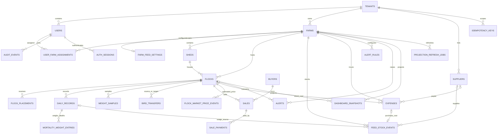

# MVP ERD

Status: Design proposal for owner review. This is a logical ERD, not a migration. Names/types may be refined after approval; business rules in `decisions.md` remain authoritative.

## Relationship diagram

All references are tenant-scoped. The diagram omits repeated `tenant_id` edges for readability. `tenants` is the tenancy root and is the one intentional exception to `tenant_id`; every other listed table has a non-null `tenant_id`, except the explicitly global Super Admin user/session case described below.

## Shared rules

- Use UUID primary keys. For tenant-owned tables, add `UNIQUE (tenant_id, id)` and use composite foreign keys `(tenant_id, referenced_id)` so an accidental cross-tenant reference fails in PostgreSQL.
- `tenant_id` is assigned from authenticated server context, is immutable to clients, and is `NOT NULL` on all tenant-owned data.
- All business timestamps are `timestamptz` in UTC. `record_date`, `occurred_on`, and date keys are PostgreSQL `date` values interpreted in the farm's configured timezone, default `Asia/Karachi`.
- Money fields use `NUMERIC(14,2)` PKR. Weight and feed quantities use `NUMERIC(12,3)` kg. Unit conversions retain the entered bag size on the event that used it.
- Counts are integers with `CHECK (count >= 0)`; record-level count fields are `NOT NULL DEFAULT 0` only where zero means an explicitly entered zero. Missing days are represented by absence plus a derived gap, never a synthetic row.
- Mutable shared rows have `version BIGINT NOT NULL DEFAULT 1` for optimistic locking. Daily create uses tenant-scoped idempotency. Edits write `audit_events` in the same database transaction.
- Add indexes for tenant filtering first, then common date/status/filter fields. Do not use a JSON projection as source of truth.

## Table inventory, constraints, and indexes

`PK` = primary key; `FK` = foreign key; `UQ` = unique; `CK` = check. Suggested indexes are explicit design targets; migrations may tune after query-plan evidence.

| Table | Core columns (all IDs UUID) | Constraints and indexes |
|---|---|---|
| `tenants` | `id PK`, `name`, `status`, nullable `plan_code`, nullable `user_limit`, nullable `farm_limit`, timestamps | `name NOT NULL`; limits nullable, when set `CK >= 0`; `status` constrained to supported lifecycle values. No `tenant_id` because this is the root. |
| `users` | `id PK`, nullable `tenant_id`, `email`, `password_hash`, `display_name`, `role`, `status`, timestamps, `version` | Normal users require tenant; global `super_admin` requires `tenant_id IS NULL`; `UQ (tenant_id, normalized_email)` plus `UQ (normalized_email) WHERE tenant_id IS NULL`; Argon2 hash only; role/status checks. Index `(tenant_id, status, role)`. Separate identities for Super Admin and tenant users. |
| `user_farm_assignments` | `tenant_id`, `user_id`, `farm_id`, `assigned_at`, `assigned_by_user_id` | `PK (tenant_id,user_id,farm_id)`; composite FKs to users/farms; assigned role restricted to Manager/Worker per approved matrix; index `(tenant_id,farm_id,user_id)`. |
| `auth_sessions` | nullable `tenant_id` for global admin, `id PK`, `user_id`, `refresh_token_hash`, `issued_at`, `expires_at`, `revoked_at` | FK to user; unique token hash; expiry after issue; never store raw refresh token. Index `(tenant_id,user_id,revoked_at,expires_at)`. |
| `farms` | `tenant_id`, `id PK`, `name`, `location_text`, `timezone`, `status`, timestamps, `version` | `UQ (tenant_id,id)`; timezone validated; proposed `UQ (tenant_id,lower(name))\) if case-insensitive uniqueness is approved; index `(tenant_id,status,name)`. |
| `sheds` | `tenant_id`, `id PK`, `farm_id`, `name`, nullable `capacity_birds`, `status`, timestamps, `version` | Composite farm FK; `CK capacity_birds IS NULL OR >=0`; `UQ (tenant_id,farm_id,lower(name))`; index `(tenant_id,farm_id,status)`. |
| `flocks` | `tenant_id`, `id PK`, `farm_id`, `shed_id`, `name_or_code`, `placed_on`, nullable `closed_at`, `status`, `version`, timestamps | Composite FKs; shed must belong to farm via composite unique/FK; status checks; index `(tenant_id,farm_id,status,placed_on DESC)` and `(tenant_id,shed_id,status)`. Current birds are never stored as editable data. |
| `flock_placements` | `tenant_id`, `id PK`, `flock_id`, `placed_on`, `bird_count`, nullable `placement_avg_weight_kg`, `source_note`, `created_by`, `created_at` | Composite FK; `CK bird_count > 0`; weight nonnegative; index `(tenant_id,flock_id,placed_on)`. Supports multiple placement facts without a mutable placed total. |
| `daily_records` | `tenant_id`, `id PK`, `flock_id`, `record_date`, `deaths`, `culling`, `feed_used_quantity`, `feed_used_unit` (`kg`/`bag`), nullable `bag_size_kg_snapshot`, nullable `water_liters`, nullable `temperature_c`, nullable `notes`, actor/timestamps, `version` | Composite FK; `UQ (tenant_id,flock_id,record_date)`; counts nonnegative; feed quantity nonnegative and bag size required only for bag input; water is liters and temperature is °C; no zero-fill for gaps. Domain derives feed kg from entered quantity/unit and bag-size snapshot. Index `(tenant_id,record_date DESC,flock_id)` and `(tenant_id,flock_id,record_date)`. |
| `mortality_weight_entries` | `tenant_id`, `id PK`, `daily_record_id`, `entry_number`, `dead_bird_count`, `total_weight_kg`, `recorded_by`, `created_at` | Composite FK to daily record; `UQ (tenant_id,daily_record_id,entry_number)`; dead count > 0, total weight kg > 0; append-only weights for a day's deaths; domain validates aggregate dead_bird_count against that daily record's deaths before treating the day's dead biomass as complete. Index `(tenant_id,daily_record_id)`. |
| `weight_samples` | `tenant_id`, `id PK`, `flock_id`, `sampled_on`, `sample_size`, `average_weight_kg`, `created_by`, timestamps, `version` | Composite FK; `CK sample_size > 0`, weight > 0; index `(tenant_id,flock_id,sampled_on DESC)`. Avoid a unique weekly bucket until “week” boundary is approved. |
| `bird_transfers` | `tenant_id`, `id PK`, `from_flock_id`, `to_flock_id`, `transfer_date`, `bird_count`, nullable `reason`, `created_by`, timestamps | Both composite FKs same tenant; `CK from_flock_id <> to_flock_id`, `bird_count > 0`; one transfer fact updates source and target derivations atomically; indexes `(tenant_id,from_flock_id,transfer_date)` and `(tenant_id,to_flock_id,transfer_date)`. |
| `buyers` | `tenant_id`, `id PK`, `name`, nullable `phone`, nullable `notes`, `status`, timestamps | `UQ (tenant_id,id)`; no global uniqueness on phone; index `(tenant_id,name)`. |
| `sales` | `tenant_id`, `id PK`, `flock_id`, `buyer_id`, `sold_on`, `birds`, `total_weight_kg`, `rate_per_kg`, `amount_pkr`, `created_by`, `updated_by`, timestamps, `version` | Composite FKs; `CK birds > 0`, weight/rate/amount nonnegative; total weight is kg, rate PKR/kg. Do not force `amount = weight × rate` until rounding/override policy is approved. Indexes `(tenant_id,sold_on DESC,buyer_id)`, `(tenant_id,flock_id,sold_on)`, `(tenant_id,buyer_id,sold_on DESC)`. |
| `flock_market_price_events` | `tenant_id`, `id PK`, `flock_id`, `effective_on`, `market_rate_per_kg`, `entered_by`, `created_at` | Composite tenant FKs; rate is nonnegative NUMERIC PKR/kg; append-only price facts; index `(tenant_id,flock_id,effective_on DESC,created_at DESC)`. Estimated revenue uses birds alive × latest average weight × latest applicable entered market rate. |
| `sale_payments` | `tenant_id`, `id PK`, `sale_id`, `paid_on`, `amount_pkr`, nullable `payment_reference`, `created_by`, `created_at` | Composite sale FK; `CK amount_pkr > 0`; payment is a separate fact; index `(tenant_id,sale_id,paid_on)`; buyer outstanding index path through sales. Overpayment policy remains open. |
| `suppliers` | `tenant_id`, `id PK`, `name`, nullable `phone`, nullable `notes`, `status`, timestamps | `UQ (tenant_id,id)`; index `(tenant_id,status,name)`. No payable balance/ledger in MVP. |
| `expenses` | `tenant_id`, `id PK`, `farm_id`, nullable `flock_id`, nullable `supplier_id`, `incurred_on`, `category`, `allocation_scope` (`direct_flock`/`farm`), `amount_pkr`, `description`, audit actor fields, timestamps, `version` | Composite FKs; direct requires flock; farm-level requires `flock_id IS NULL`; amount > 0; `CK` for scope/FK shape. Indexes `(tenant_id,farm_id,incurred_on DESC)`, `(tenant_id,flock_id,incurred_on DESC)`. Edits audited. |
| `farm_feed_settings` | `tenant_id`, `farm_id PK`, `bag_size_kg`, `updated_by`, `updated_at`, `version` | Composite farm FK; `bag_size_kg > 0`; one active conversion setting per farm; historical bag entries retain the conversion snapshot used when recorded. Index `(tenant_id,farm_id)`. |
| `feed_stock_events` | `tenant_id`, `id PK`, `farm_id`, `event_type` (`opening`, `purchase`, `return`, `adjustment`), `occurred_on`, `quantity`, `unit` (`kg`/`bag`), nullable `bag_size_kg_snapshot`, nullable `supplier_id`, nullable `expense_id`, nullable `reason`, `created_by`, timestamps | Composite FKs; quantity > 0; bag size required for bag input; return means return into stock and adds; adjustment has explicit direction; purchase may link one feed expense with partial unique `(tenant_id,expense_id)`. Index `(tenant_id,farm_id,occurred_on DESC,event_type)`. Usage comes from daily records, not a duplicate feed event. Domain converts quantities to kg from source quantity/unit and recorded bag-size snapshot. |
| `alert_rules` | `tenant_id`, `id PK`, `farm_id`, `alert_type`, `threshold_numeric`, `enabled`, `updated_by`, timestamps, `version` | Composite FK; threshold nonnegative; `UQ (tenant_id,farm_id,alert_type)`; types: mortality, missing record, low feed cover, FCR target. Units and trigger semantics are configurable design details to approve. Index `(tenant_id,farm_id,enabled,alert_type)`. |
| `alerts` | `tenant_id`, `id PK`, `farm_id`, nullable `flock_id`, `alert_type`, `period_key`, `created_at`, nullable `resolved_at`, display-only `payload` JSONB | Composite FKs; deduplication key on tenant/farm/type/period/flock with explicit null handling; index `(tenant_id,farm_id,resolved_at,created_at DESC)`. Alerts are regenerable from facts/rules. |
| `audit_events` | `tenant_id`, `id PK`, `actor_user_id`, `occurred_at`, `entity_type`, `entity_id`, `action`, `before_value` JSONB, `after_value` JSONB, nullable `reason`, `request_id` | FK actor_user_id to globally unique users.id (actor may be tenant user or global Super Admin); service validates authorization; append-only; old/new values required for edit action; MVP edits cover daily records, sales, expenses. Indexes `(tenant_id,entity_type,entity_id,occurred_at DESC)` and `(tenant_id,occurred_at DESC)`. |
| `idempotency_keys` | `tenant_id`, `id PK`, `user_id`, `key`, `request_hash`, `response_status`, `response_body` JSONB, `created_at`, `expires_at` | Composite FK; `UQ (tenant_id,user_id,key)`; reject same key with different request hash; index expiry for cleanup. |
| `dashboard_snapshots` | `tenant_id`, `id PK`, `farm_id`, nullable `flock_id`, `snapshot_date`, `projection_version`, `computed_at`, `is_stale`, derived `payload` JSONB | Composite FKs; unique key on tenant/farm/flock/date/version with explicit null strategy; projection is disposable/rebuildable. Indexes `(tenant_id,farm_id,snapshot_date DESC,is_stale)` and `(tenant_id,flock_id,snapshot_date DESC)`. |
| `projection_refresh_jobs` | `tenant_id`, `id PK`, `farm_id`, nullable `flock_id`, `from_date`, `reason`, `requested_at`, nullable `claimed_at`/`completed_at`, `attempts`, nullable `last_error_code` | Composite FKs; `CHECK attempts >= 0`; jobs are coalesced by tenant/farm/flock/date where possible; worker claims with row locks; indexes `(tenant_id,completed_at,requested_at)` and `(tenant_id,farm_id,flock_id,from_date)`. Errors contain safe codes, not secrets or PII. |

## Derivation and source-of-truth map

| Displayed value | Source facts | Stored as source of truth? |
|---|---|---|
| Closing birds | Placements, daily deaths/culling, sales birds, transfers | No. Derive in the pure domain module. |
| Mortality and total loss | Placements and daily records | No. Derive; culling remains separate from deaths. |
| Running/final FCR | Daily feed facts, weight samples, placements, sales, and mortality weight entries | No. Rebuild from facts. Count coverage is validated against daily deaths before dead biomass is considered complete. |
| Feed stock | Opening/purchase/return/adjustment events minus daily feed usage converted to kg | No. Events, settings snapshots, and daily records are facts. |
| Buyer balance | Sales amount minus payment facts | No. Derive per buyer. |
| Profit | Sales, direct/farm expenses, approved cost allocation config | No. Derived result; estimated and actual remain distinct. |
| Dashboard snapshot | Derived values from facts above | Cache/projection only; rebuildable and invalidated per ADR 0005. |

## Planned seams (not MVP feature tables)

Keep separate module boundaries for medicine/vaccination, fuller inventory, notifications, accounting extensions, and offline synchronization. Add their tables only when scope is approved. Tenant plan/limit fields are nullable billing seams, not billing behavior. Farm assignments support Manager/Worker scope; Accountant finance view is tenant-wide per the approved matrix.

## Review assumptions and gaps

- Proposed tenancy is shared schema with composite tenant-aware FKs; RLS is a defense-in-depth option in ADR 0001.
- The user table allows `tenant_id NULL` only for a global Super Admin; normal users always have a tenant. This is an explicit platform identity exception, not a tenant business record.
- Dead-bird biomass comes from separate mortality weight entries attached to daily records. The day's dead biomass is complete only when entry counts sum to that day's deaths; missing or partial measurements do not get extrapolated. Confirm this validation behavior during ERD review.
- Feed returns add to stock, as confirmed in Phase 0. Here `return` means return into farm stock.
- Direct/farm expense assignment and sale amount rounding/overrides require validation rules before migrations.
