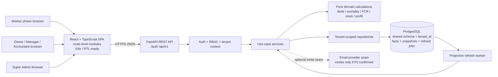

# System design

Status: Design proposal for Phase 1 review. No application code is included.

## System diagram



The browser sends user intent and renders server-calculated values. The server derives tenant context from the authenticated identity; clients never choose tenant_id. Request handling flows from API to service, then to pure domain functions and tenant-scoped repositories. The domain does not call repositories or import frameworks. Services coordinate domain functions and repository transactions.

## Module boundaries

| Module | Owns | May depend on | Must not own |
|---|---|---|---|
| `api` | HTTP routing, input parsing, authorization dependency wiring, pagination/error envelope | Services, API schemas | SQL, formulas, tenant IDs supplied by clients |
| `services` | Use cases, transaction boundaries, permission-sensitive orchestration, audit writes, idempotency | Domain, repository interfaces, schemas | HTTP concerns or duplicate calculation formulas |
| `domain` | Pure bird, mortality, FCR, feed-stock, and profit calculations; value rules | Standard library and domain types | FastAPI, SQLAlchemy, HTTP, database/repositories, UI |
| `repositories` | Tenant-scoped persistence queries and writes | SQLAlchemy/PostgreSQL, database session | Authorization policy decisions, formulas |
| `models` / `db` | Persistence mapping, constraints, migrations, session configuration | SQLAlchemy, PostgreSQL | Use-case orchestration |
| `core` | Settings, authentication primitives, logging, safe errors | Standard library and narrowly scoped security libraries | Business calculations |
| `frontend/services` | Typed HTTP client and resource calls | API contracts, Axios | Derived business totals |
| `frontend/pages` / `components` | Role-aware screen composition, form state, accessible display | UI primitives, frontend services, query cache | Persistence access or formula recomputation |

### Request and write flow

1. Auth middleware validates the access token and establishes a tenant/user/role context.
2. API validates the request shape and invokes an authorized service.
3. The service opens an explicit transaction and passes facts to pure domain functions as needed.
4. A repository applies tenant context to every query. Write operations use optimistic versions; daily create also uses an idempotency key.
5. Facts and audit entries commit together. Any required dashboard projection is updated or marked stale in the same transaction/outbox boundary.
6. API returns calculated response fields and a consistent error envelope. The frontend caches and displays them.

### Cross-cutting seams

- `tenant_context`: authenticated tenant and user identity, required by repositories.
- `audit`: append-only actor/time/before/after record for edits to daily records, sales, and expenses.
- `idempotency`: tenant + user + key + request hash + stored result, scoped to create operations that promise retries.
- `outbox`: optional reliable projection invalidation if inline invalidation becomes insufficient; no external message broker in MVP.
- Inventory/medicine/vaccination/accounting/notifications remain separate future modules; no unused domain tables are added solely for these seams.

## Data flow summary

```mermaid
sequenceDiagram
  participant W as Worker phone
  participant UI as Daily entry screen
  participant API as API + auth
  participant S as Daily record service
  participant D as Pure domain
  participant R as Tenant repository
  participant DB as PostgreSQL
  W->>UI: Enter today's facts
  UI->>API: POST daily record + Idempotency-Key
  API->>S: Authenticated context + validated facts
  S->>R: Load flock and current facts in tenant scope
  R->>DB: Tenant-filtered query, transaction
  S->>D: Derive closing count and validation result
  D-->>S: Calculated result / domain error
  S->>R: Persist fact, audit/projection invalidation
  R->>DB: Commit
  S-->>API: Saved record + server calculations
  API-->>UI: Success response
  UI-->>W: Confirm saved; retain draft until confirmed
```
